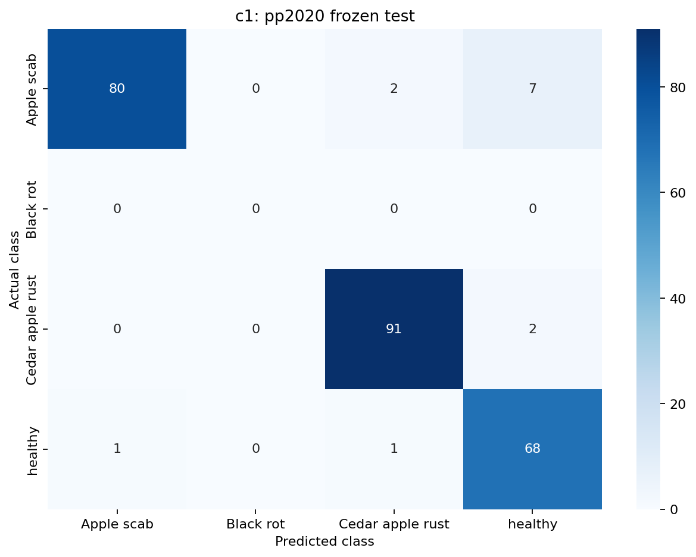

# C1 held-out evaluation and three-model comparison

Evaluation date: 2026-10-22. This experiment runs inference only.

## Outcome

**C1 substantially improved held-out PP2020 recognition and matched the
reference's PlantVillage accuracy and macro-F1.** The robust model improved
PP2020 results more modestly and scored one additional correct PV prediction.

| Model | PV test accuracy | PV macro-F1 | PP2020 test accuracy | PP2020 macro-F1 (3 classes) |
| --- | ---: | ---: | ---: | ---: |
| Reference | 99.79% (474/475) | 0.9982 | 48.41% (122/252) | 0.4347 |
| Robust | 100.00% (475/475) | 1.0000 | 56.75% (143/252) | 0.5528 |
| C1 field-adapted | 99.79% (474/475) | 0.9982 | 94.84% (239/252) | 0.9465 |

Relative to reference, C1 gained **46.43 percentage points** of PP2020 accuracy
and **0.5118** macro-F1. Relative to robust, it gained **38.10 percentage points**
and **0.3937** macro-F1. These are observed differences on the frozen tests;
no statistical significance or cross-orchard guarantee is asserted.

### Per-class recall

| PP2020 class | Reference | Robust | C1 |
| --- | ---: | ---: | ---: |
| Scab (89) | 76.40% (68/89) | 75.28% (67/89) | 89.89% (80/89) |
| Cedar Rust (93) | 0.00% (0/93) | 21.51% (20/93) | 97.85% (91/93) |
| Healthy (70) | 77.14% (54/70) | 80.00% (56/70) | 97.14% (68/70) |
| Black Rot (0) | Unmeasured | Unmeasured | Unmeasured |

The strongest change is Cedar Rust recognition. C1 also improved Scab and Healthy
recall. Reference, robust, and C1 predicted black rot on 36, 10, and zero PP2020
images respectively; those outputs are retained as errors, not discarded.
Secondary PP2020 all-four-class macro-F1 values are 0.3260, 0.4146, and 0.7099.
They include a zero-F1 absent black-rot class and are not the headline metric.

| PlantVillage class | Reference | Robust | C1 |
| --- | ---: | ---: | ---: |
| Scab (95) | 98.95% (94/95) | 100.00% (95/95) | 98.95% (94/95) |
| Black Rot (93) | 100.00% | 100.00% | 100.00% |
| Cedar Rust (41) | 100.00% | 100.00% | 100.00% |
| Healthy (246) | 100.00% | 100.00% | 100.00% |

C1 and reference have different single PV errors: C1 corrected the reference's
scab-to-healthy mistake but introduced another scab-to-healthy mistake
(`f79c50ef-d89d-4371-b581-810b37eb2ac9___FREC_Scab 3255.JPG`, confidence 0.7927).
Thus matching aggregate metrics does not mean identical behavior. On PP2020,
C1 corrected 124 reference errors and regressed on seven previously correct
examples; versus robust, it corrected 100 and regressed on four. C1 still made
13 PP2020 errors, including seven scab-to-healthy predictions.

### Confusion matrices

Rows are ground truth, columns are predictions. The full CSV and PNG matrices
for all six evaluations are in the result snapshot. C1's PP2020 matrix is:

| True / Predicted | Scab | Black Rot | Cedar Rust | Healthy |
| --- | ---: | ---: | ---: | ---: |
| Scab | 80 | 0 | 2 | 7 |
| Black Rot | 0 | 0 | 0 | 0 |
| Cedar Rust | 0 | 0 | 91 | 2 |
| Healthy | 1 | 0 | 1 | 68 |



### Confidence analysis

| PP2020 model | Mean score | Mean score on errors | Predictions >= 0.90 | Errors among these | Error rate among these | 10-bin ECE | NLL |
| --- | ---: | ---: | ---: | ---: | ---: | ---: | ---: |
| Reference | 0.7794 | 0.7118 | 87 | 25 | 28.74% | 0.3020 | 3.0978 |
| Robust | 0.7937 | 0.7499 | 96 | 23 | 23.96% | 0.2460 | 1.6503 |
| C1 | 0.9548 | 0.7315 | 213 | 1 | 0.47% | 0.0165 | 0.1329 |

C1 has fewer highly confident mistakes and better descriptive ECE/NLL on
PP2020. Its scores remain uncalibrated; the single high-confidence error shows
that confidence cannot certify a diagnosis. No confidence cutoff was fitted.
Ten fixed bins and correct/error histograms are saved for every evaluation.
On PV, none of the models made errors at >= 0.90. C1's PV NLL was 0.0094 versus
reference 0.0051 and robust 0.0033, so matching headline performance does not
mean every score-quality measure was preserved.

### Verification and decision

All 54 repository tests passed, including eight new evaluation tests.
The separate saved-result verifier passed all six evaluations. Every original
PV label/prediction was reproduced for reference and robust; maximum probability
differences were about 6.98e-10 and 7.92e-09 respectively. Frozen checkpoints,
manifests, histories and recorded configuration files were unchanged.
Total model/dataset inference time was about 72 seconds, excluding the full
input audits and result serialization.

The evidence supports C1 as the stronger classifier candidate for the evaluated
PP2020 setting, with no observed loss of reference PV accuracy/macro-F1. It does
not establish universal orchard diagnosis, field black-rot reliability, or the
correctness of segmentation. Keep the demo's checkpoint unchanged until a
separate integration decision; do not tune using these test results.

## Research question

Did fine-tuning EfficientNet-B0 with real PP2020 orchard photographs improve
recognition on held-out field images while preserving PlantVillage performance?
The background-robust model supplies a second comparison: whether the existing
PlantVillage-only robustness recipe was sufficient without orchard training.

## Models and frozen inputs

All models retain four outputs in this exact order: Scab (0), Black Rot (1),
Cedar Apple Rust (2), Healthy (3). Checkpoints were selected using validation
scores, not the results of this experiment.

| Model | Training | Selected epoch | Checkpoint under `artifacts/` |
| --- | --- | ---: | --- |
| Reference | PlantVillage, original transfer recipe | 11 | `efficientnet_b0/apple_efficientnet_b0_checkpoint.pt` |
| Robust | PlantVillage, robust augmentation recipe | 13 | `efficientnet_b0_robust/apple_efficientnet_b0_robust_checkpoint.pt` |
| C1 | Reference initialization, PlantVillage + PP2020 fine-tuning | 10 | `efficientnet_b0_field_c1_v1/apple_efficientnet_b0_field_c1_checkpoint.pt` |

Checkpoint SHA-256 values:

```text
Reference d6b94fa0b61250b28930e92e1c676fce89b6575204ba510b3258f521f53d078c
Robust    bd141c6b7cd078b96f122e6d8ebf36c576a3037c0642a7afa9d31856d43a4919
C1        2d2b223e25f0d2fc21bf26a3ff158dbc61294043e80a0ca0bac8618ba2a2fac7
```

| Frozen test source | Scab | Black Rot | Cedar Rust | Healthy | Total |
| --- | ---: | ---: | ---: | ---: | ---: |
| PlantVillage | 95 | 93 | 41 | 246 | 475 |
| PP2020 split-v1 | 89 | 0 | 93 | 70 | 252 |

The original test manifests are
`artifacts/efficientnet_b0/test_manifest.csv` and
`data/field_manifests/pp2020_split_v1/test.csv`. No split is regenerated or
reassigned. All models receive the same ordered manifest for each source.
The 727 unique test images are reported as two separate datasets; there is no
pooled headline accuracy or pooled macro-F1.

PlantVillage test predictions were already available for the reference and
robust checkpoints. This is a repeat measurement of a training-held-out split
for those models, not a claim that all 727 images were previously uninspected.

## Implementation procedure and reasons for each step

1. **Validate checkpoints and provenance before inference.**
   `src/appleleaf/cli/evaluate_c1.py` checks architecture, input size, class
   mapping, preprocessing, normalization, training strategy, and validation
   selection against each saved training history. It verifies C1's initialization
   reference and all frozen input hashes embedded in C1. This prevents a different
   checkpoint, class order, or changed manifest from silently entering the comparison.
2. **Validate held-out membership and actual images.** The evaluator runs
   `scripts/build_pp2020_field_splits.py --verify`, including frozen report hashes,
   duplicate groups, prior-use restrictions, and deterministic assignment replay.
   It checks reference/robust PV inventories and C1's saved training/validation
   inventories. It then decodes all 4,843 images across PV train/validation/test
   (2,214/475/475) and PP2020 train/validation/test (1,176/251/252), checks recorded
   identities, and rejects repeated paths or normalized pixels within/across
   the six splits. PP2020 bytes are also checked against their saved hashes.
   This checks actual content, beyond trusting the manifest filenames.
3. **Apply identical deterministic inputs.** `FieldDataset(training=False)` uses
   EXIF-oriented RGB, full-image bicubic resize to 224 x 224, ToTensor, and ImageNet
   mean/std `(0.485, 0.456, 0.406)` / `(0.229, 0.224, 0.225)`. The audit verifies
   that EXIF orientation leaves PV pixels unchanged, preserving the original PV
   preprocessing. No crop or test-time augmentation is applied.
4. **Run six frozen evaluations.** Each checkpoint is loaded in evaluation mode;
   `predict` disables gradients. Data loaders use batch size 16, no shuffling,
   and zero workers. This run used CPU with four PyTorch threads. No optimizer,
   training epoch, threshold search, calibration fit, or checkpoint write occurs.
5. **Measure each source separately.** Accuracy counts every wrong output as an
   error. PV macro-F1 averages all four classes. PP2020 headline macro-F1 averages
   Scab, Cedar Rust, and Healthy, while retaining all four softmax outputs.
   A black-rot prediction on PP2020 remains wrong; probabilities are never
   renormalized over three classes. All-four PP2020 macro-F1 is saved as a
   secondary value. Black-rot recall on PP2020 is null/unmeasured, not a measured
   zero. Four-by-four confusion matrices retain the absent row and every output.
6. **Analyze confidence and paired errors.** Save all four probabilities, maximum
   softmax score, ten fixed confidence bins, mean scores for correct/wrong
   predictions, errors at confidence >= 0.90, descriptive ten-bin ECE, and
   negative log-likelihood. These are diagnostics, not calibrated disease
   probabilities. Paired comparisons count corrected errors, regressions, both
   correct, and both wrong for every model pair on each source.
7. **Save and verify results.** Output goes into a new, non-overwriting directory.
   At completion, all recorded frozen input hashes are rechecked. The separate
   `scripts/verify_c1_comparison.py` verifies CSV/NPZ alignment and recalculates
   accuracy/F1/recall directly from confusion counts, checks confidence and paired
   counts, and compares reference/robust PV predictions with their original
   saved predictions. This verification does not load models or rerun inference.

## Reproduction

Run from the repository root. Input validation alone writes no results:

```powershell
.venv\Scripts\python.exe -m appleleaf.cli.evaluate_c1 --validate-only
```

The completed experiment uses:

```powershell
.venv\Scripts\python.exe -m appleleaf.cli.evaluate_c1 --device cpu --batch-size 16 --threads 4
.venv\Scripts\python.exe scripts/verify_c1_comparison.py
```

The evaluator refuses to overwrite the existing run. A deliberate repeat must
use a fresh path, for example `--output-dir artifacts/c1_heldout_comparison_v2`;
pass the matching `--root` to the verifier. Repeated tests must not drive tuning.

## Artifact layout

Local run: `artifacts/c1_heldout_comparison_v1/`.
Portable snapshot: `results/2026-10-22_c1_heldout/`.

- `input_validation.json`: checks, source/checkpoint hashes, selected-model
  metadata, environment versions, preprocessing, counts, and prior test exposure.
- `plantvillage_test_manifest.csv`, `pp2020_test_manifest.csv`: exact input order.
- `comparison.csv`: six source/model rows with headline metrics and recall.
- `paired_comparison.csv`: every model-pair comparison and metric differences.
- `*_paired_predictions.csv`: aligned per-image outputs for all three models.
- `{reference,robust,c1}/{plantvillage,pp2020}/`: metrics JSON, predictions CSV/NPZ,
  errors CSV ordered by confidence, per-class metrics, confusion matrix CSV/PNG,
  confidence bins CSV, and confidence-distribution PNG.
- `completion.json`: successful six-evaluation completion and preserved inputs.

Datasets and weights remain local under the existing ignore policy. The snapshot
contains predictions, reports and figures; it does not contain source images or
model weights. Original training metadata is retained as historical evidence.

## Interpretation boundaries

This is a comparison of the three saved training recipes. C1 changes data,
sampling, and fine-tuning exposure together; it is not an ablation isolating the
causal contribution of source data alone. The robust recipe also includes
geometry, light/colour, and image-quality augmentation beyond backgrounds.

PP2020 results measure transfer to held-out images from that orchard dataset.
They do not establish performance across new farms, seasons, devices, or all
apple diseases. PP2020 has no black-rot support, so this experiment cannot
establish field black-rot recall. Exact-content and audited duplicate checks do
not prove that every remaining photograph is an independent leaf/acquisition.

This experiment evaluates classifiers only; it provides no new lesion segmentation
or combined-pipeline accuracy evidence. Results do not automatically replace the
demo checkpoint. Preserve these test results without test-guided retraining or
threshold selection, and use genuinely unseen data for later confirmation.
